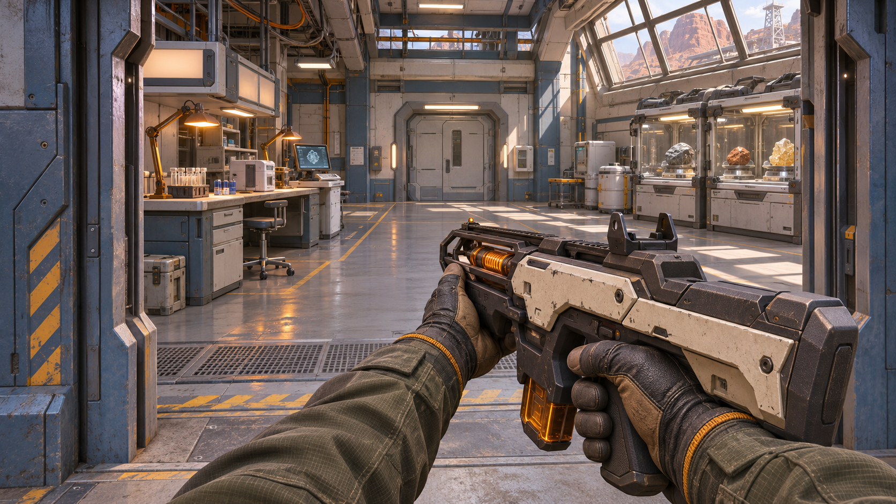
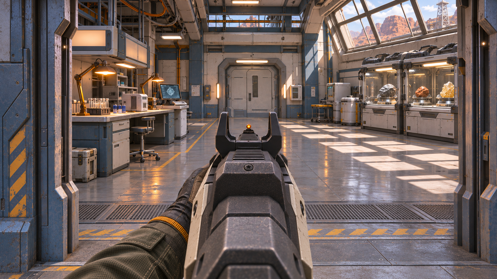
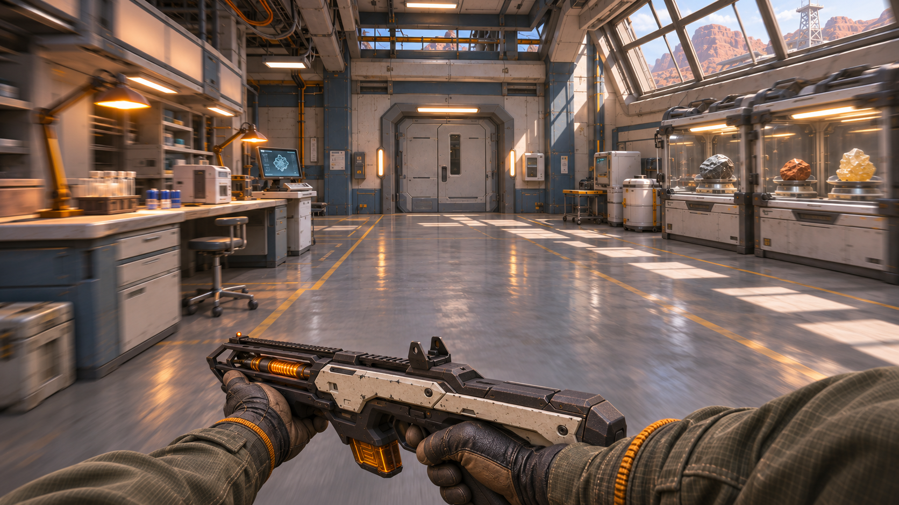
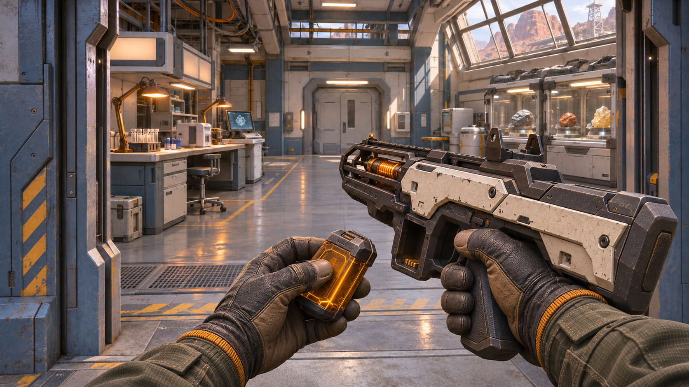

# Vesper auf Nysa-3 · Referenzen für die First-Person-Animation

Vier mit ImageGen erstellte Zielbilder zeigen denselben Operator im selben Labor. Die Tragehaltung war die Bildvorlage für die drei Varianten. Olivfarbener Stoff, dunkles Handschuhleder, die helle Seitenplatte und die bernsteinfarbene Zelle machen es leicht, Hände und Ausrüstung beim Wechsel der Haltung wiederzuerkennen. Die Tür auf der Mittelachse dient als fester Bezugspunkt für die Kamera. [Verwendete Prompts](prompts.json)

| Tragehaltung | ADS |
| --- | --- |
|  |  |
| Sprint | Zellenwechsel |
|  |  |

## Was in der Spielerkamera lesbar sein soll

| Pose | Vorgabe für Animation und FPV |
| --- | --- |
| Tragehaltung | Die rechte Hand umfasst den hinteren Griff. Der linke Ärmel führt bis zum Daumenballen unter dem Vorderbau. Die Manschette folgt dem Handgelenk. Das Zentrum der Tür bleibt frei. |
| ADS | Der Gehäuserücken läuft auf eine schmale Visiergabel zu. Der orange Punkt ist zwischen beiden Seiten erkennbar. Die rechte Hand darf hinter dem Gehäuse verschwinden. Im Zielbild liegt der Punkt leicht über der vertikalen Bildmitte. Im Spiel bestimmt der tatsächliche Zielstrahl die präzise Lage. |
| Sprint | Die Front der Vesper wandert nach links unten. Der Laufweg wird sichtbar, während beide Hände ihre Griffstellen behalten. Die veränderte Silhouette trägt die Bewegung auch bei klarer Sicht. |
| Zellenwechsel | Die rechte Hand trägt die gekippte Vesper. Die linke Hand ist samt Manschette zu sehen und umfasst die herausgenommene Zelle. Zwischen Zelle und Öffnung bleibt ein Stück Hintergrund sichtbar. Damit erkennt der Spieler, wohin die Hand als Nächstes führt. |

## Übergabe an Animation und Rigging

Beim Übergang zwischen Tragehaltung, Sprint und ADS bleiben beide Hände am Objekt. Beim Zellenwechsel löst sich die linke Hand, während die rechte die Last übernimmt. Für den Vergleich im Spiel dieselbe Tür als Blickpunkt verwenden und Eintritt, ausgeprägteste Pose und Rückkehr mit derselben Bildgröße nebeneinander ansehen.

Die ausgebaute Zelle ist ein neues Animationsziel. Im bisherigen Spielstand bleibt sie eingesetzt. Die letzte geprüfte Außenansicht zeigt eine Durchdringung am mittleren Glied des linken Ringfingers. Die frühere Freigabe anhand der Handgelenkmarker hat diesen Fehler übersehen. Bei der nächsten Abnahme beide vollständigen Fingerketten und die Unterarmdrehung in den deformierten Spielposen mitprüfen. Die verdeckten Kontakte und das Timing zwischen den vier Zielbildern erfordern bewegte Spielaufnahmen. [Außenansicht der deformierten Gliedmaßen mit markierten Fingersegmenten](baseline/front-L.png)

Die Gameplay-Animation und die technische Charakterprüfung haben alle vier Bilder unabhängig auf Handrollen, Verdeckungen und freie Sicht geprüft. Die Bilder liegen im Autorenbereich des Projekts. Der Spielbuild verwendet die gekochten 3D-Assets.
