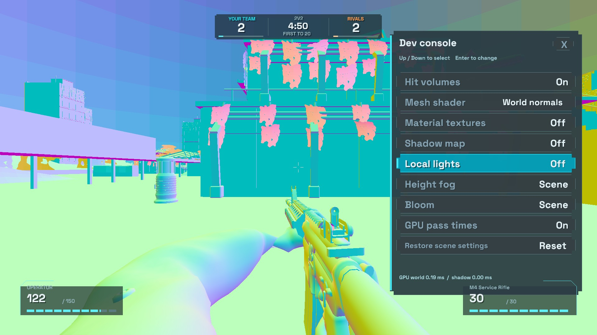
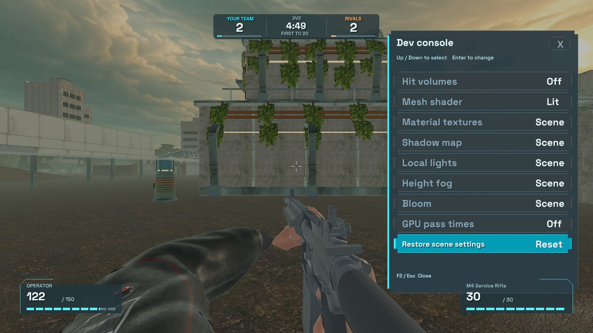
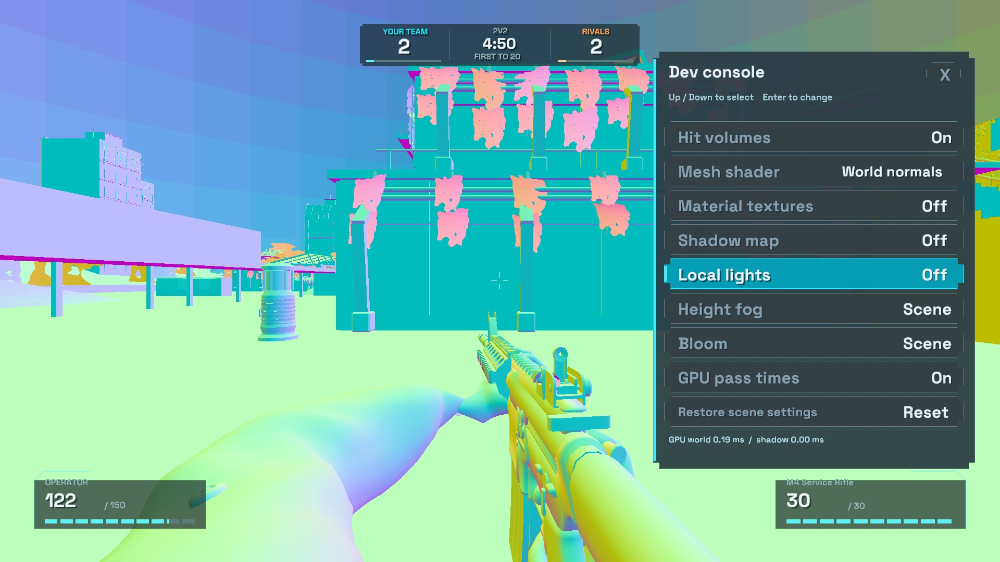

# Private match and live renderer inspection

The integrated Nysa test started a 2v2 match from the main menu. One local player shared the match with three independently posed bots. The host recorded 38 bot hits through tick 960. Escape returned to the main menu with zero active sessions and zero remote mesh handles.

| World normals and host hit volumes | Scene settings restored |
| --- | --- |
|  |  |

F2 opens the console and releases the pointer. Arrow keys and Enter also operate the controls. Live hit outlines use the host's four floor-relative damage volumes and standing or crouched pose. The head, torso and two legs are distinct. Practice-range targets use their actual collision shapes. For this sample the test changed the mesh shader, disabled material textures, directional shadows and local lights, enabled GPU pass timers, then restored scene settings. The game continued simulating throughout the sequence.

The Vulkan capture sampled 92 images at 1920 × 1080 on an RTX 3070 Ti. The private desktop audit checked the input desktop 196 times and observed zero foreground violations. The isolated game executable SHA-256 was `1d17f1a2d0335465a98587296ad1715b9ba8002f9603534806bd81d58e496ffc`. Its local source pair includes changes beyond game base `e1d8801bb249bacb3afd0c8377d1bc08f4be481c` and engine base `fbbbfb3a18e945c28c2dc0bc7c5a8d8f8d541f56`. The images document that paired build. Individual release PRs qualify their own exact game, engine and map.

In a separate repeatable 45-second CPU exercise, three bots covered 132–203 m on Nysa and 164–227 m on Helion. The local player respawned and was reacquired on both maps. The combined four-player simulation took 0.184 ms per tick at p99 on Nysa and 0.073 ms on Helion in one isolated run. These numbers measure simulation cost. The private test does not establish a 165 Hz display result.

## Final integrated Release

The final executable had SHA-256 `2ce69724382fe5cc3d5c8d812709db90ed165af06c4e0345afd17b25ddad0a14`. Its local source checkpoints were game `24859e89411ff88bcfafa4aa2f5e0a6fd8433abe` and engine `43424c114f455a9610f84817a19a0eb904872fd5`. This image is one of 91 sampled at native 1920×1080. The repeated match reached 38 host-confirmed hits through tick 960, and Escape released the session and all three remote mesh handles. The test desktop recorded zero focus violations in 179 checks.

| Workload on the RTX 3070 Ti | Measurement |
| --- | --- |
| One moving Nysa Vesper player at 1920×1080, daylight, mailbox, 360 simulation ticks, image capture off | 4,608 application intervals. Median 1.33 ms, p95 1.85 ms, p99 2.21 ms and maximum 22.36 ms. Three intervals exceeded 6.06 ms. GPU world pass p99 was 0.705 ms. |
| Helion 6v6 with six native 1080p Vulkan clients and six headless UDP players | Direct and impaired runs both reached server tick 600. Each peer matched all 122 terminal fields. The two test desktops recorded zero foreground violations across 455 and 461 checks. |

The Nysa result measures application submissions on a six-second route. A monitor-output measurement is still needed for a sustained 165 Hz claim. In the integrated suite, 61 of 62 game tests and all 11 engine tests passed. All seven game GPU tests passed. The game failure is the M4 hand/contact regression in `nemisis_project_rifle_ready_tests`.
