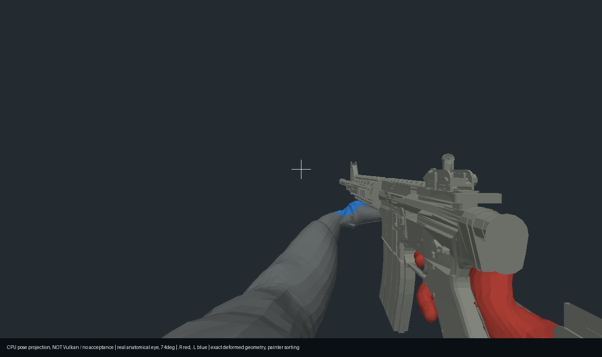

# Armed Idle offline diagnostic — 2026-10-19

This is the actual deformed Project character/M4 geometry projected from the
anatomical eye at 74 degrees. Red marks the anatomical right hand, blue the left.
It uses a diagnostic CPU painter; it does not reproduce Vulkan depth, material,
lighting or shadows. The label is embedded in the original generated image.

Source: First-Person candidate `812118e65d7af863c01e8ca0c2eaf73a66b18e8b` after
`56486275469bcead6e79b26c3fc1f0f8c02865f1`. The source/cook reproductions, strict
contact/fade tests and independent CPU occlusion gates are recorded in
[PHASE5_M4_ARMED_IDLE.md](../../PHASE5_M4_ARMED_IDLE.md).

The image was copied byte-for-byte from the agent's final diagnostic, without
editing. SHA256: `25b15e4ce4a0fb25437bd4f9af81455f8831fab1f1434ab2a035d41fe2107856`.
The actual old Vulkan failure images remain unchanged. A new Vulkan comparison
of the integrated candidate requires fresh GUI authorization and remains open.
